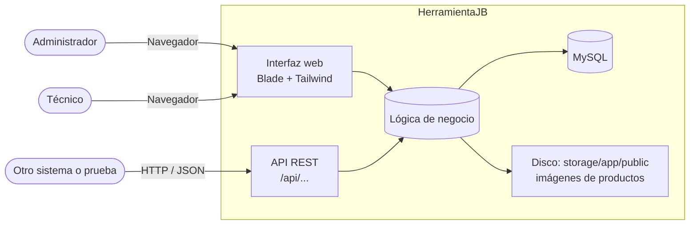

# 3. Contexto y alcance

## Contexto del sistema

| Quién o qué           | Cómo se comunica                      | Para qué                                           |
|-----------------------|---------------------------------------|----------------------------------------------------|
| Administrador         | Navegador web                         | Gestionar todo el sistema                          |
| Técnico               | Navegador web                         | Salidas, máquinas y mantenimientos                 |
| Clientes y sistemas externos | API REST en `/api`             | Consultar y modificar recursos (hoy sin autenticación) |
| MySQL                 | Eloquent / Query Builder              | Guardar todos los datos                            |
| Disco local           | `Storage::disk('public')`             | Guardar las imágenes de los productos              |

## Alcance

| Dentro del alcance                                   | Fuera del alcance                                   |
|------------------------------------------------------|-----------------------------------------------------|
| Inventario con entradas, salidas y alertas           | Facturación electrónica ante la DIAN                |
| Cotizaciones y ventas internas                       | Pagos en línea                                      |
| Máquinas, hoja de vida y mantenimientos              | Tienda en línea para clientes                       |
| Usuarios, roles e historial de actividad             | Recuperación de contraseña por correo               |
| API REST para los 18 recursos                        | Aplicación móvil                                    |

!!! note
    Las cotizaciones y comprobantes dicen *«Documento sin validez como factura»*. Son documentos internos.
