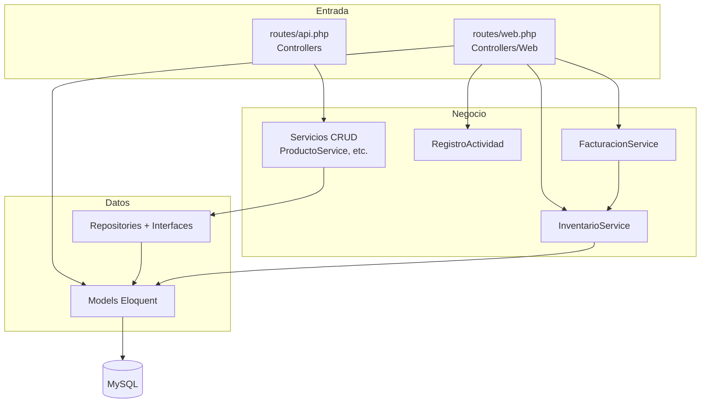

# 5. Vista de bloques

## Nivel 1 · Las capas

## Nivel 2 · Carpeta por carpeta

| Carpeta                              | Qué contiene                                                                                   |
|--------------------------------------|------------------------------------------------------------------------------------------------|
| `app/Http/Controllers/`              | Controladores de la **API** (uno por recurso, devuelven JSON)                                  |
| `app/Http/Controllers/Web/`          | Controladores de la **interfaz web** (devuelven vistas y redirecciones)                        |
| `app/Http/Controllers/Web/Auth/`     | `LoginController` (iniciar y cerrar sesión)                                                    |
| `app/Http/Middleware/`               | `VerificarRol`: deja pasar solo a los roles indicados                                          |
| `app/Http/Requests/`                 | Validaciones. `*Request` para la web; `Store*Request` y `Update*Request` para la API           |
| `app/Services/`                      | Lógica de negocio: `InventarioService`, `FacturacionService`, `RegistroActividad` y un servicio CRUD por recurso |
| `app/Interfaces/`                    | Contratos de los repositorios (`BaseInterface` y uno por recurso)                              |
| `app/Repositories/`                  | Acceso a datos. `BaseRepository` tiene el CRUD común                                           |
| `app/Models/`                        | 18 modelos Eloquent con sus relaciones                                                         |
| `app/Exceptions/`                    | `StockInsuficienteException`                                                                   |
| `app/Providers/`                     | Enlaza cada interfaz con su repositorio                                                        |
| `database/migrations/`               | Tablas numeradas del 01 al 18, más `sessions`                                                  |
| `database/seeders/`                  | `RolesYAdministradorSeeder` (mínimo) y `DatabaseSeeder` (datos de ejemplo)                     |
| `resources/views/`                   | Pantallas Blade, una carpeta por módulo, más `layouts/`, `components/` y `partials/`           |
| `resources/css/app.css`, `resources/js/app.js` | Estilos Tailwind 4 y JavaScript de la interfaz                                       |
| `lang/es/validation.php`             | Mensajes de validación en español                                                              |
| `.scribe/`, `config/scribe.php`      | Configuración y caché de la documentación automática de la API                                 |

## Nivel 2 · Módulos de la interfaz

| Módulo        | Controlador web                | Vistas                       | Rol que entra          |
|---------------|--------------------------------|------------------------------|------------------------|
| Panel         | `DashboardController`          | `dashboard`                  | Administrador y Técnico|
| Productos     | `ProductoController`           | `productos/`                 | Ver: ambos · Editar: admin |
| Categorías    | `CategoriaController`          | `categorias/`                | Administrador          |
| Proveedores   | `ProveedorController`          | `proveedores/`               | Administrador          |
| Entradas      | `EntradaController`            | `entradas/`                  | Administrador          |
| Movimientos   | `MovimientoController`         | `movimientos/`               | Administrador y Técnico|
| Alertas       | `AlertaController`             | `alertas/`                   | Administrador y Técnico|
| Máquinas      | `MaquinaController`            | `maquinas/`                  | Ver: ambos · Editar: admin |
| Hoja de vida  | `HojaVidaController`           | `hojas-vida/`                | Administrador y Técnico|
| Mantenimientos| `MantenimientoController`      | `mantenimientos/`            | Ambos (eliminar: admin)|
| Cotizaciones  | `CotizacionController`         | `cotizaciones/`              | Administrador          |
| Ventas        | `VentaController`              | `ventas/`                    | Administrador          |
| Usuarios      | `UsuarioController`            | `usuarios/`                  | Administrador          |
| Historial     | `HistorialController`          | `historial/`                 | Administrador          |
