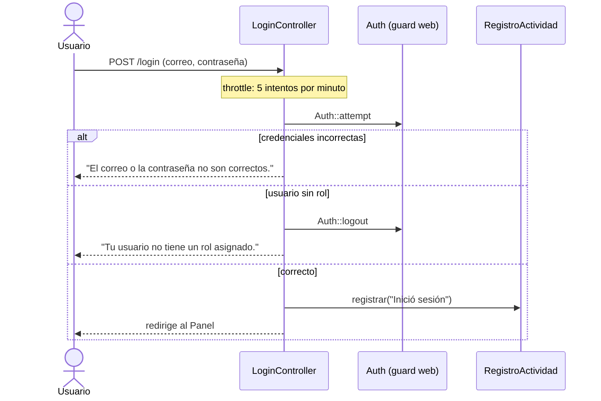
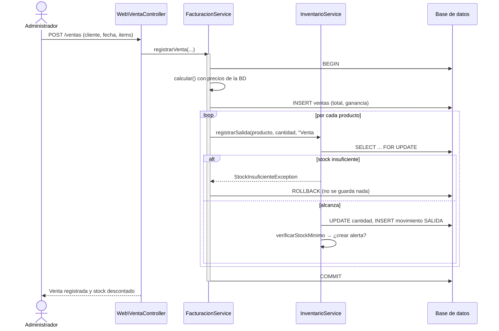

# 6. Vista de ejecución

Tres recorridos que muestran cómo trabajan juntas las piezas.

## Escenario 1 · Iniciar sesión



## Escenario 2 · Registrar una venta



!!! info "Cómo se enlaza la venta con sus productos"
    La tabla `ventas` no tiene tabla de detalle. Cada salida de stock guarda el texto `Venta #<id>` en `movimiento_inventario.motivo`, y la pantalla de la venta reconstruye las líneas buscando ese texto.

## Escenario 3 · Alerta de stock bajo

```mermaid
flowchart TD
    A[Se registra una salida o se edita un producto] --> B{cantidad <= stock_minimo?}
    B -- No --> Z[No pasa nada]
    B -- Sí --> C{¿Ya hay una alerta<br/>sin leer de este producto?}
    C -- Sí --> Z
    C -- No --> D[Crea alerta en alertas_inventario:<br/>«Stock bajo: ... tiene N unidad(es) (mínimo M)»]
    D --> E[Aparece en Alertas y en el contador rojo del menú]
    E --> F[El usuario la marca como leída]
```
