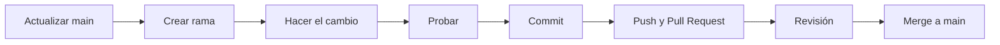

# Cómo contribuir

## Flujo de trabajo



```bash
git checkout main
git pull
git checkout -b feat/alerta-por-correo

# ... haz tus cambios ...

git add .
git commit -m "feat: avisar por correo cuando hay stock bajo"
git push -u origin feat/alerta-por-correo
```

Luego abre un *Pull Request* en GitHub y pide que alguien del equipo lo revise.

## Nombres de rama

| Prefijo    | Para…                          | Ejemplo                       |
|------------|--------------------------------|-------------------------------|
| `feat/`    | Una función nueva              | `feat/descuento-en-ventas`    |
| `fix/`     | Corregir un error              | `fix/total-de-cotizacion`     |
| `docs/`    | Cambios en la documentación    | `docs/guia-de-permisos`       |
| `refactor/`| Ordenar código sin cambiar su comportamiento | `refactor/unificar-providers` |

## Mensajes de commit

Formato `tipo: qué se hizo`, en presente y en español: `feat:`, `fix:`, `docs:`, `refactor:`, `test:`, `chore:`.

## Antes de subir

- [ ] El proyecto arranca: `php artisan serve` y `npm run dev`
- [ ] Probaste el cambio **como Administrador y como Técnico**
- [ ] Pasan las pruebas: `php artisan test`
- [ ] El código sigue el estilo del proyecto: `./vendor/bin/pint`
- [ ] **No** subiste `.env`, contraseñas ni la carpeta `vendor/` o `node_modules/`
- [ ] Si tocaste una tabla, hay una **migración nueva** (no editaste las antiguas)
- [ ] Si cambiaste algo que explica esta documentación, la actualizaste

## Trabajar esta documentación

Este sitio se genera con [MkDocs Material](https://squidfunk.github.io/mkdocs-material/). Los archivos están en `docs/` y la navegación en `mkdocs.yml`.

```bash
pip install mkdocs-material
mkdocs serve        # vista previa en http://127.0.0.1:8000
mkdocs build        # genera la carpeta site/
```

### Publicar en GitHub Pages

```bash
mkdocs gh-deploy --force
```

Después, en GitHub ve a **Settings → Pages** y elige la rama `gh-pages`. Antes de publicar, cambia `site_url`, `repo_url` y `repo_name` en `mkdocs.yml` por los de tu repositorio.

!!! tip "Publicación automática"
    También puedes usar una acción de GitHub que ejecute `mkdocs gh-deploy` cada vez que se haga *merge* a `main`.

!!! note "Puerto en conflicto"
    Si usas Docker con la aplicación en el puerto 8000, lanza MkDocs en otro: `mkdocs serve -a 127.0.0.1:8001`.
