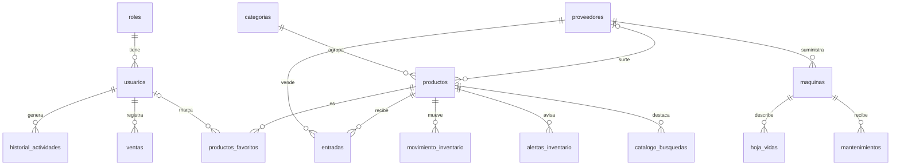

# Base de datos

18 tablas de negocio numeradas del `01` al `18`, más la tabla `sessions`. Todas (menos `sessions`, que la usa Laravel de forma especial) tienen `created_at`, `updated_at` y `deleted_at` (ver [ADR-0003](decisiones/0003-borrado-logico.md)).

## Diagrama



Las tablas `cotizaciones`, `configuracion_alertas` y `registros_conectividad` no tienen llaves foráneas.

## Usuarios y seguridad

### `roles` · 01

| Campo     | Tipo         | Notas                                   |
|-----------|--------------|-----------------------------------------|
| `id_rol`  | BIGINT PK    |                                         |
| `nombre`  | VARCHAR(100) | «Administrador» o «Técnico»             |

### `usuarios` · 04

| Campo             | Tipo         | Notas                                              |
|-------------------|--------------|----------------------------------------------------|
| `id_usuario`      | BIGINT PK    |                                                    |
| `nombre_completo` | VARCHAR(100) |                                                    |
| `correo`          | VARCHAR(100) | **Único**. Se usa para iniciar sesión              |
| `contraseña`      | VARCHAR(255) | Con *hash* (bcrypt)                                |
| `id_rol`          | BIGINT FK    | → `roles`. Nulo si se elimina el rol               |

### `historial_actividades` · 05

| Campo          | Tipo      | Notas                             |
|----------------|-----------|-----------------------------------|
| `id_historial` | BIGINT PK |                                   |
| `accion`       | TEXT      | Ejemplo: `Creó el producto "…"`   |
| `id_usuario`   | BIGINT FK | → `usuarios` (cascada)            |

## Catálogo e inventario

### `categorias` · 02

| Campo          | Tipo         | Notas |
|----------------|--------------|-------|
| `id_categoria` | BIGINT PK    |       |
| `nombre`       | VARCHAR(100) |       |
| `descripcion`  | TEXT         | Opcional |

### `proveedores` · 03

| Campo          | Tipo         | Notas    |
|----------------|--------------|----------|
| `id_proveedor` | BIGINT PK    |          |
| `nombre`       | VARCHAR(100) |          |
| `telefono`     | VARCHAR(20)  | Opcional |
| `empresa`      | VARCHAR(100) | Opcional |

### `productos` · 06

| Campo           | Tipo          | Notas                                              |
|-----------------|---------------|----------------------------------------------------|
| `id_producto`   | BIGINT PK     |                                                    |
| `nombre`        | VARCHAR(100)  |                                                    |
| `descripcion`   | TEXT          | Opcional                                           |
| `marca`         | VARCHAR(100)  | Opcional                                           |
| `imagen`        | VARCHAR(255)  | Ruta dentro de `storage/app/public`. Opcional      |
| `cantidad`      | INT           | Stock actual. Por defecto 0. **No se edita a mano**|
| `stock_minimo`  | INT           | Por defecto 5. Umbral de la alerta                 |
| `precio_compra` | DECIMAL(10,2) | Costo                                              |
| `precio_venta`  | DECIMAL(10,2) | No puede ser menor que `precio_compra`             |
| `id_categoria`  | BIGINT FK     | → `categorias`                                     |
| `id_proveedor`  | BIGINT FK     | → `proveedores`. Opcional                          |

### `entradas` · 07

| Campo          | Tipo      | Notas              |
|----------------|-----------|--------------------|
| `id_entrada`   | BIGINT PK |                    |
| `cantidad`     | INT       |                    |
| `fecha`        | DATE      |                    |
| `id_producto`  | BIGINT FK | → `productos`      |
| `id_proveedor` | BIGINT FK | → `proveedores`    |

### `movimiento_inventario` · 08

| Campo           | Tipo                    | Notas                                    |
|-----------------|-------------------------|------------------------------------------|
| `id_movimiento` | BIGINT PK               |                                          |
| `tipo`          | ENUM(`ENTRADA`,`SALIDA`)|                                          |
| `cantidad`      | INT                     |                                          |
| `motivo`        | VARCHAR(255)            | Ejemplo: `Venta #4`, `Entrada #2 de proveedor` |
| `fecha`         | DATE                    |                                          |
| `id_producto`   | BIGINT FK               | → `productos`                            |

### `alertas_inventario` · 10

| Campo         | Tipo         | Notas                      |
|---------------|--------------|----------------------------|
| `id_alerta`   | BIGINT PK    |                            |
| `id_producto` | BIGINT FK    | → `productos`              |
| `mensaje`     | VARCHAR(255) |                            |
| `leido`       | BOOLEAN      | Por defecto `false`        |

### `configuracion_alertas` · 09

| Campo                       | Tipo      | Notas                    |
|-----------------------------|-----------|--------------------------|
| `id_configuracion`          | BIGINT PK |                          |
| `dias_anticipacion_entrega` | INT       | Por defecto 2            |

### `catalogo_busquedas` · 11

| Campo         | Tipo      | Notas                       |
|---------------|-----------|-----------------------------|
| `id_catalogo` | BIGINT PK |                             |
| `id_producto` | BIGINT FK | → `productos`               |
| `destacado`   | BOOLEAN   | Por defecto `false`         |

### `productos_favoritos` · 12

| Campo         | Tipo      | Notas                          |
|---------------|-----------|--------------------------------|
| `id_favorito` | BIGINT PK |                                |
| `id_usuario`  | BIGINT FK | → `usuarios`. Opcional         |
| `id_producto` | BIGINT FK | → `productos`                  |

## Costeo y facturación

### `cotizaciones` · 13

| Campo                     | Tipo          | Notas                                                              |
|---------------------------|---------------|--------------------------------------------------------------------|
| `id_cotizacion`           | BIGINT PK     |                                                                    |
| `cliente_telefono`        | VARCHAR(255)  | Opcional                                                           |
| `productos_seleccionados` | JSON          | `[{"id_producto","nombre","marca","cantidad","precio_unitario","subtotal"}]` |
| `total`                   | DECIMAL(10,2) |                                                                    |

### `ventas` · 14

| Campo            | Tipo          | Notas                                |
|------------------|---------------|--------------------------------------|
| `id_venta`       | BIGINT PK     |                                      |
| `cliente`        | VARCHAR(255)  |                                      |
| `fecha`          | DATE          |                                      |
| `total_venta`    | DECIMAL(10,2) |                                      |
| `ganancia_total` | DECIMAL(10,2) |                                      |
| `id_usuario`     | BIGINT FK     | → `usuarios`. Quién registró la venta|

## Taller

### `maquinas` · 15

| Campo          | Tipo         | Notas                                |
|----------------|--------------|--------------------------------------|
| `id_maquina`   | BIGINT PK    |                                      |
| `nombre`       | VARCHAR(100) |                                      |
| `referencia`   | VARCHAR(100) | **Única**. Serie o referencia        |
| `fecha_compra` | DATE         |                                      |
| `id_proveedor` | BIGINT FK    | → `proveedores`                      |

### `hoja_vidas` · 16

| Campo                       | Tipo      | Notas                              |
|-----------------------------|-----------|------------------------------------|
| `id_hoja_vida`              | BIGINT PK |                                    |
| `fecha_ingreso`             | DATE      | Ingreso a servicio en el taller    |
| `especificaciones_tecnicas` | TEXT      | Voltaje, potencia, consumo. Opcional |
| `id_maquina`                | BIGINT FK | → `maquinas`                       |

### `mantenimientos` · 17

| Campo                 | Tipo                        | Notas                           |
|-----------------------|-----------------------------|---------------------------------|
| `id_mantenimiento`    | BIGINT PK                   |                                 |
| `tipo_mantenimiento`  | ENUM(`preventivo`,`correctivo`) |                             |
| `descripcion`         | TEXT                        | Fallas, reparaciones, repuestos |
| `fecha`               | DATE                        |                                 |
| `tecnico_responsable` | VARCHAR(100)                | Opcional. Texto libre           |
| `id_maquina`          | BIGINT FK                   | → `maquinas`                    |

### `registros_conectividad` · 18

| Campo             | Tipo      | Notas                               |
|-------------------|-----------|-------------------------------------|
| `id_conectividad` | BIGINT PK |                                     |
| `estado_conexion` | BOOLEAN   | `true` = en línea                   |
| `fecha_registro`  | TIMESTAMP |                                     |

## Sesiones

`sessions` es la tabla estándar de Laravel para `SESSION_DRIVER=database`: `id`, `user_id`, `ip_address`, `user_agent`, `payload` y `last_activity`.

## Comandos útiles

```bash
php artisan migrate                 # crea las tablas que falten
php artisan migrate:fresh --seed    # BORRA todo y carga datos de ejemplo
php artisan db:seed --class=RolesYAdministradorSeeder   # solo roles y administrador
```
