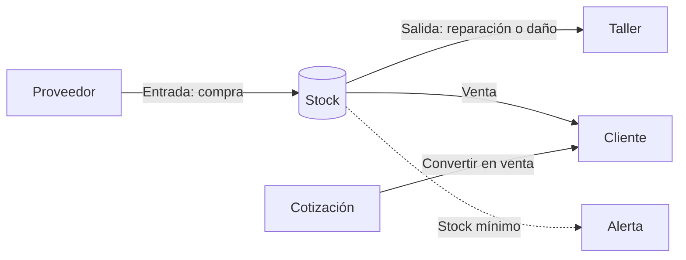

# HerramientaJB

Sistema web de **inventario, taller y facturación** para *HerramientaJB*, un taller electromecánico. Controla los repuestos y herramientas que entran y salen, avisa cuando el stock se está acabando, lleva la hoja de vida y los mantenimientos de cada máquina, y registra cotizaciones y ventas con su ganancia.

Cada cambio de stock queda guardado con fecha y motivo, y cada acción importante queda en un historial por usuario. Así siempre se sabe **qué se movió, cuándo y quién lo hizo**.

## ¿Qué estás buscando?

| Quiero…                                           | Ve a                                              |
|---------------------------------------------------|---------------------------------------------------|
| Poner el proyecto a funcionar en mi computador    | [Instalación](primeros-pasos/instalacion.md)       |
| Saber con qué usuario entrar y qué probar         | [Usuarios de prueba](primeros-pasos/usuarios-prueba.md) |
| Entender cómo está construido el sistema          | [Arquitectura](arquitectura/index.md)              |
| Saber **dónde** hacer un cambio en el código      | [¿Dónde hago el cambio?](guias/index.md)           |
| Entender **por qué** algo se hizo de cierta forma | [Decisiones (ADR)](decisiones/index.md)            |
| Ver las tablas y sus campos                       | [Base de datos](datos.md)                          |
| Consultar los endpoints de la API                 | [API REST](api.md)                                 |
| Subir mis cambios al repositorio                  | [Cómo contribuir](contribuir.md)                   |

## Tecnologías

| Parte              | Tecnología                                   | Carpeta / archivo          |
|--------------------|----------------------------------------------|----------------------------|
| Backend            | Laravel 12 · PHP 8.3                         | raíz del repositorio       |
| Interfaz web       | Blade · Tailwind CSS 4 · Vite                | `resources/`               |
| API REST           | Laravel (`routes/api.php`)                   | `app/Http/Controllers/`    |
| Base de datos      | MySQL (SQLite por defecto en `.env.example`) | `database/`                |
| Entorno            | Docker Compose                               | `docker-compose.yml`       |
| Documentación      | MkDocs Material (este sitio) y Scribe (API)  | `docs/`, `.scribe/`        |

## Roles del sistema

Cada persona entra con un rol y ve solo el menú y las pantallas que le corresponden. Si intenta abrir una página que no es suya, ve la pantalla **«Zona restringida»** (error 403).

| Rol               | Qué hace en HerramientaJB                                                                 | Pantallas                                                                                                              |
|-------------------|-------------------------------------------------------------------------------------------|------------------------------------------------------------------------------------------------------------------------|
| **Administrador** | Gestiona todo: catálogo, compras, ventas, cotizaciones, máquinas, usuarios e historial.   | Panel (con ventas y ganancias), Productos, Categorías, Proveedores, Entradas, Movimientos, Alertas, Máquinas, Mantenimientos, Cotizaciones, Ventas, Usuarios, Historial |
| **Técnico**       | Consulta stock, registra salidas de repuestos, y lleva hojas de vida y mantenimientos.    | Panel (sin datos de dinero), Productos (solo ver), Movimientos, Alertas, Máquinas, Mantenimientos                      |

Los permisos completos están en [Cambiar permisos o roles](guias/permisos.md).

## Estado del proyecto

| Ya funciona                                                    | Pendiente                                                  |
|----------------------------------------------------------------|------------------------------------------------------------|
| Inicio de sesión con permisos por rol (Administrador y Técnico)| Autenticación en la API REST                               |
| Productos con categoría, proveedor, imagen y stock mínimo      | Recuperación de contraseña                                 |
| Entradas (compras) y salidas con trazabilidad                  | Pantallas web para favoritos, catálogo y conectividad      |
| Alertas automáticas de stock bajo                              | Pruebas automatizadas (hoy solo hay las de ejemplo)        |
| Cotizaciones y ventas con descuento de stock transaccional     | Detalle de venta propio (hoy se reconstruye desde movimientos) |
| Máquinas, hoja de vida y mantenimientos preventivos/correctivos|                                                            |
| Historial de actividad por usuario                             |                                                            |

Los problemas técnicos conocidos están en [Riesgos y deuda técnica](arquitectura/11-riesgos.md).

## Equipo

Proyecto académico del **Tecnólogo en Análisis y Desarrollo de Software**, SENA, Bogotá.

- Yeny Paola Silva Camargo
- Leonardo Garavito
- Laura Sofia Barrera
